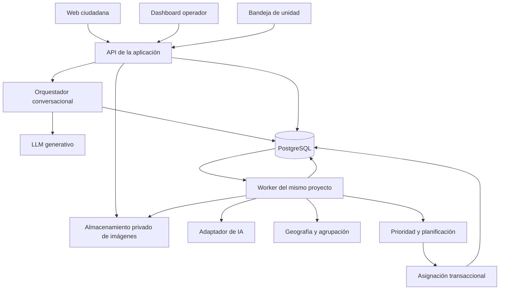

# Radar Urbano — propuesta de arquitectura

Arquitectura recomendada para implementar · documentación de Jev e infraestructura revisada el 17 de octubre de 2026. No desplegada ni probada con credenciales todavía.

## 1. Decisión principal

Un monolito modular con una aplicación web y un worker del mismo repositorio, PostgreSQL como fuente de verdad y almacenamiento privado de imágenes. Ambos procesos comparten los módulos de dominio. La web recibe y consulta; el worker procesa IA y decisiones pendientes. Esto permite reintentar después de una caída sin depender de mantener una pestaña o petición HTTP abierta.

Stack recomendado: TypeScript sobre Node.js 22 o superior, Next.js para interfaz/API, Zod para contratos, PostgreSQL mediante `pg` y migraciones SQL, Leaflet y Turf para geografía. Railway ejecuta web y worker; Supabase aporta PostgreSQL, Auth y Storage privado. Jev es el proveedor de decisiones mediante `@typesafe-ai/sdk`; OpenAI Responses API es la integración recomendada para el LLM generativo, con modelo configurable pendiente de prueba de latencia/calidad. El equipo no tiene restricciones de stack ni infraestructura preexistente. Versiones exactas de dependencias se fijan en el lockfile al implementar.

Turf alcanza para los 62 polígonos del piloto. Cargar las geometrías desde la base y validar su versión; usar PostGIS al crecer el volumen, manteniendo el contrato del módulo geográfico. No sumar Redis, una base vectorial ni microservicios para este MVP.

## 2. Módulos y límites

| Módulo | Responsabilidad |
| --- | --- |
| Intake | Sesión ciudadana, borrador, adjuntos, confirmación e idempotencia |
| Assessment | Contratos de evaluación y adaptador de Jev |
| Conversation | Historial, propuestas de campos, aclaraciones y adaptador LLM |
| TextGeneration | Resúmenes y explicaciones desde evidencia/resultados versionados |
| Geography | Cobertura, áreas, coordenadas y candidatos por proximidad |
| Grouping | Comparación con candidatos, asociación reversible y trazabilidad |
| Incidents | Evidencia agregada, revisiones y estado operativo |
| Dispatch | Validar propuestas del plan, reservar capacidad y emitir órdenes |
| Planning | Ordenar demanda, distribuir capacidad y generar un plan versionado con motivos |
| Access | Sesiones, pertenencia a unidad/territorio y permisos |
| Jobs | Trabajo persistido, reintentos, leases y recuperación |

La IA propone resultados estructurados; el backend valida referencias, aplica políticas y modifica datos. Los mensajes ciudadanos y el texto de las imágenes son evidencia, nunca instrucciones con autoridad para ejecutar acciones. El proveedor no recibe herramientas para crear órdenes directamente.

## 3. Recorrido de un reporte

1. Crear sesión ciudadana opaca mediante cookie segura. Crear un borrador persistido y subir adjuntos privados; guardar hash de contenido, tipo detectado y tamaño. Los límites vienen de configuración.
2. Guardar descripción y ubicación confirmada. Permitir análisis preliminar del borrador para mostrar la ficha y pedir aclaraciones. Este análisis nunca crea incidentes ni órdenes.
3. Confirmar envío: una transacción fija la revisión del reporte y crea un job único para esa revisión. Responder con recepción y seguimiento; la UI consulta el progreso.
4. El worker reutiliza un análisis preliminar solo si coinciden el contenido, revisión, catálogo y política. Si cambiaron, vuelve a evaluar. Guardar respuesta validada y versión del proveedor.
5. Calcular cobertura y barrio; dejar pendientes visibles si falta ubicación o cobertura. La cobertura definida por unión de barrios sirve para la demo, pero no se presenta como límite administrativo completo verificado.
6. Buscar candidatos del territorio y comparar mediante IA. Asociar, crear incidente o dejar en revisión según el resultado.
7. Reevaluar el incidente con evidencia acumulada, preservar correcciones manuales y calcular prioridad mediante política versionada.
8. Disparar planificación del territorio. El planificador ordena el conjunto de pendientes y propone unidades considerando capacidad y especialidades. Dispatch revalida y convierte las propuestas elegibles en órdenes mediante transacciones. La bandeja lee órdenes de la base; no hay notificación externa en el MVP.

La ficha puede mostrar «recibido», «analizando» o «necesita información». Un código visible no autoriza acceso: la sesión ciudadana solo puede consultar sus reportes. No exponer listado público de imágenes o reportes anónimos.

## 4. Persistencia mínima

| Grupo | Tablas / datos |
| --- | --- |
| Configuración | `territories`, `areas`, `problem_types`, capacidades y habilitación por territorio, `policy_versions` |
| Recepción | `citizen_sessions`, `conversations`, `messages`, `reports`, `attachments` |
| Generación | `llm_runs`, textos derivados con referencias y revisión de origen |
| Decisiones | `ai_runs`, `grouping_decisions`, `incident_assessments` |
| Incidentes | `incidents`, `report_incident_links`, correcciones manuales |
| Atención | `response_units`, capacidades, `area_responsibilities`, `assignments` |
| Planificación | `planning_policies`, `plan_runs`, `plan_items` con revisiones, orden, unidad propuesta y razones |
| Ejecución | `jobs`, `events`, usuarios internos y vínculo con unidades/territorios |

Relaciones, identificadores, estados y revisiones usan columnas y restricciones SQL. Evidencia estructurada, salidas validadas y políticas versionadas pueden usar JSONB. Las decisiones guardan los IDs de evidencia considerados, no únicamente un resumen imposible de rastrear.

Un reporte tiene como máximo un vínculo activo con un incidente. Los vínculos anteriores quedan inactivos con motivo y fecha. Cada incidente tiene una revisión creciente; una evaluación guarda la revisión sobre la que se calculó.

`response_units` guarda estado operativo (habilitada/fuera de servicio) y capacidad. Disponibilidad se deriva de capacidad menos órdenes activas, evitando dos fuentes contradictorias. Posición y su fecha son opcionales para responsables de zona.

La reputación de la fuente queda fuera de estas tablas del MVP. No crear una implementación vacía de todo el roadmap.

## 5. Estados independientes

| Dimensión | Valores propuestos |
| --- | --- |
| Envío de reporte | borrador / confirmado |
| Procesamiento | pendiente / procesando / completado / error recuperable |
| Resultado del reporte | aplicable / no relacionado / información insuficiente / fuera de cobertura |
| Agrupación | pendiente / asociado / revisión |
| Revisión del incidente | sin revisión / requiere revisión, con motivo |
| Prioridad | baja / media / alta, puede ser desconocida si aún no se evaluó |
| Operación del incidente | abierto / asignado / en atención / resuelto / archivado |
| Orden | ofrecida / aceptada / en curso / completada / rechazada / cancelada |

«Requiere revisión» no sustituye prioridad: un fuego puede seguir destacado como alto y a la vez necesitar revisión. «Pendiente de recurso» es un motivo de asignación pendiente, no un segundo estado incompatible del incidente.

Aceptar una orden mantiene el incidente asignado; iniciar trabajo lo lleva a en atención. Completar resuelve el incidente y libera capacidad. Rechazar/cancelar libera capacidad y devuelve el incidente a abierto con revisión. Si el operador resuelve manualmente, debe cerrar o cancelar la orden activa en la misma transacción, registrando el motivo.

Las correcciones del operador se registran como overrides por campo. Una reevaluación conserva el valor efectivo corregido y muestra cualquier discrepancia; quitar el override es una acción explícita. Las reglas pueden elevar una alerta de peligro sin borrar la corrección del operador.

## 6. Contratos de IA

Tres funciones de dominio para Jev, separadas del adaptador LLM generativo:

- `evaluateReport(input)`: aplicabilidad, tipo del catálogo, condición, severidad, evidencia, contradicciones e información faltante.
- `compareCandidates(input)`: candidato elegido o ninguno, `same_incident / different_incident / uncertain`, evidencia y contradicciones.
- `assessIncident(input)`: evaluación agregada, cambios respecto de la anterior, fuentes y evidencia utilizadas.

Todas devuelven un resultado validado o un error tipado. Jev documenta probabilidades por opción y confianza para Choice/Score; Noul devuelve probabilidad de verdadero sin confianza separada. La capacidad está documentada; falta medirla con nuestros ejemplos y credenciales. La política verifica tanto la respuesta elegida como su confianza, nunca confianza sola. Ver [contrato de integración con Jev](./INTEGRACION-JEV.md).

El catálogo activo y los criterios se cargan desde la base. Validar que todo `problemTypeId`, candidato y referencia a evidencia devueltos pertenezcan al input permitido. El esquema estructural, algoritmos y máquinas de estado viven en código; datos operativos, parámetros y criterios de negocio viven en configuración persistida. Esta distinción evita transformar la aplicación en un intérprete universal de reglas.

Configurar límites de candidatos, evidencias, bytes y tiempo por llamada. Si el límite de candidatos impide descartar alternativas relevantes, pasar a revisión; no afirmar certeza a partir de una muestra truncada. Para evidencia agregada, conservar un resumen estructurado versionado y adjuntar evidencia nueva y representativa con sus IDs. Jev no genera texto libre: el LLM redacta motivos, resúmenes y preguntas desde hechos evaluados, evidencia y códigos de motivo. Puede proponer una dirección extraída del relato; el geocodificador y el ciudadano la confirman. Las plantillas persistidas quedan como fallback. No pedir extracción abierta a Jev.

### Conversación y generación de texto

**Dentro del MVP:** hablar con el ciudadano en español natural, entender correcciones, proponer descripción/dirección/fecha desde sus mensajes, pedir información faltante y explicar el estado de su reporte. El mismo adaptador redacta títulos, resúmenes de incidentes, breves descripciones para órdenes y explicaciones de prioridad a partir de hechos disponibles. No agregar un chat independiente de análisis para operadores durante estas 15 horas.

Proveedor recomendado: OpenAI mediante Responses API. Usar salidas estructuradas para propuestas de campos y texto dirigido a la UI; si se necesitan herramientas, el modelo solicita funciones y el servidor las ejecuta después de autorizar. La conformidad de un esquema no garantiza veracidad de su contenido. [Structured Outputs](https://developers.openai.com/api/docs/guides/structured-outputs?api-mode=responses), [function calling](https://developers.openai.com/api/docs/guides/function-calling).

El modelo concreto se elige en la prueba inicial según conversación en español, extracción fiel y latencia. Guardar proveedor, modelo, versión de instrucciones, tokens y revisión de entrada en `llm_runs`. Clave en entorno; criterios y plantillas en configuración persistida. No asumir acceso a un modelo concreto antes de verificar la cuenta.

**Contrato `conversationTurn`:** recibe historial acotado, borrador actual, estado autorizado del reporte, resultados de Jev disponibles y campos faltantes calculados por backend. Devuelve `assistantMessage`, `proposedFields` con referencias a mensajes originales, `requestedField` opcional y referencias de evidencia. Validar campos permitidos y pertenencia de cada referencia. La identidad de sesión y los permisos nunca provienen del modelo.

Cada turno se guarda antes de generar, con identificador idempotente y revisión de conversación. El servidor procesa turnos de una conversación en orden. Una respuesta calculada sobre una revisión antigua no modifica el borrador nuevo. El mensaje se entrega una vez validado; streaming es opcional y nunca habilita efectos antes de cerrar y validar el resultado.

El LLM puede proponer cambios en descripción y dirección del borrador, pero el backend valida y los muestra en la ficha. Ubicación y envío se confirman mediante controles explícitos; el modelo no confirma en nombre del usuario. Los mensajes originales se conservan y se envían a Jev como evidencia, junto con los datos confirmados; un resumen generado no sustituye la fuente ni cuenta como corroboración adicional.

El backend proporciona estado actualizado antes de contestar consultas de seguimiento. La tarjeta de estado/código se renderiza directamente desde la base. El LLM puede explicar ese estado sin prometer movilización, resolución o tiempo de llegada no registrados. No tiene acceso a órdenes ajenas, SQL, herramientas arbitrarias ni cambios de prioridad.

**Contrato `generateText`:** propósito (título/resumen/explicación), hechos y decisiones autorizados, referencias, idioma y revisión de origen → texto y referencias utilizadas. Usar el mismo adaptador en el worker y en conversación. Los textos derivados se cachean por revisión/propósito y se invalidan al cambiar evidencia o estado. Su generación no bloquea guardar un reporte, asignar una unidad o actualizar el dashboard.

Si falla el LLM, conservar el mensaje y borrador, ofrecer campos directos y textos de fallback. Si falla Jev, el LLM comunica que el análisis está pendiente; no genera decisiones sustitutivas. Aplicar límites configurados de contexto, salida, llamadas por turno, tiempo y reintentos. Mostrar atribución a la fuente y permitir correcciones sin convertir el texto del usuario en instrucciones del sistema.

**Pruebas mínimas:** corregir una dirección a mitad de conversación; preguntar por un reporte ajeno; exigir falsamente que marque como enviado; preguntar cuándo llega la unidad cuando no existe ETA; timeout del generador; nuevo mensaje mientras hay una respuesta pendiente; resumen sin hechos agregados. Reutilizar el mismo recorrido con Jev real para verificar la integración completa.

## 7. Jobs y concurrencia

Una tabla `jobs` con clave única por etapa/entidad/revisión, estado, intentos, próxima ejecución, lease y último error. El worker toma trabajos con bloqueo SQL, persiste resultados y libera el lease. Si cae, el lease vence y el trabajo vuelve a ser elegible. Los reintentos usan espera creciente y máximo configurable; al agotarlos se muestra revisión/error con reintento manual.

Para la hackatón usar un solo consumidor de procesamiento por territorio, con exclusión persistida entre instancias. Serializa agrupación y reevaluación a este volumen, evitando locks geográficos frágiles en bordes de celdas. Las llamadas de IA se hacen fuera de transacciones largas. Antes de guardar, verificar las revisiones de los datos consultados; si cambiaron por intervención del operador, descartar el resultado obsoleto y reencolar.

Para asignar: bloquear el incidente y la unidad candidata, verificar nuevamente revisión, capacidades, estado y capacidad disponible, insertar orden y evento, y confirmar todo junto. Un índice único parcial impide más de una orden activa por incidente. La capacidad de la unidad se controla dentro del bloqueo; no usar un índice universal de una orden por unidad porque las dependencias pueden aceptar varias.

Resolver/rechazar/cancelar usa los mismos bloqueos. Todos los comandos aceptan una clave de idempotencia y versión esperada. Si la versión cambió, devolver conflicto y refrescar la pantalla, sin sobrescribir silenciosamente.

Una desasociación invalida las evaluaciones afectadas y bloquea nuevos despachos hasta reevaluar. Una orden existente pasa a revisión cuando cambian tipo, ubicación o capacidad requerida. No reenviar automáticamente otra orden.

Si el incidente queda sin reportes, archivarlo y cancelar su orden activa en la misma transacción. Un reporte desasociado pasa a otro incidente o a revisión. Una orden incompatible queda bloqueada para inicio/completado hasta revisión. Buscar candidatos entre todos los incidentes abiertos cercanos, sin excluir los persistentes por siete días de inactividad; un evento nuevo posterior a un cierre crea una recurrencia vinculada. Recalcular factores temporales al consultar y antes de despachar, sin scheduler adicional para el MVP.

### Planificador determinista

`buildPlan(snapshot, policy, now)` es una función sin efectos que recibe incidentes con evaluaciones vigentes, bloqueos/overrides, unidades, órdenes activas y políticas. Devuelve cola priorizada, propuestas de asignación y pendientes con motivos. No llama a Jev ni al LLM y usa un instante de cálculo único para todas las comparaciones.

Orden lexicográfico: peligro activo, banda de prioridad efectiva, puntuación descendente de espera más corroboración, fecha de creación e ID estable. Puntuación = horas de espera + min(tope, peso × log2(max(1, fuentes distintas estimadas dentro de la ventana))). Ventana, peso y tope se leen de la política persistida; guardar conteos y desglose en PlanItem. El volumen no cambia por sí solo la banda ni la severidad. Deduplicar contribuciones por fuente/incidente/ventana y no contar reintentos o evidencia idéntica como fuentes independientes. Aplicar elegibilidad de despacho por separado; no convertir baja confianza en baja urgencia. Para cada incidente elegible, construir aristas a unidades compatibles y con capacidad libre. Elegir candidata minimizando primero el número de otros incidentes que perderían su única unidad factible si se consumiera esa plaza, luego distancia para móviles o precedencia/carga para responsables de zona y finalmente ID. Recalcular ese costo de oportunidad con la capacidad restante en cada paso. La política de despacho selecciona la familia de recursos antes de comparar; no comparar distancia de un móvil con ausencia de GPS de una dependencia.

Es una heurística voraz: no garantiza máxima cobertura ni distancia global mínima. Su alcance es ordenar y mejorar la asignación inmediata sin incorporar un solver. La antigüedad crece sin tope y el bonus por corroboración es acotado, mitigando postergación dentro de una prioridad; no garantiza atender prioridades bajas bajo saturación continua. Mostrar espera acumulada y falta de capacidad al operador.

Persistir cada `PlanRun` con revisiones de incidentes, unidades, políticas y hora. `PlanItem` guarda orden, unidad propuesta, razones y estado propuesta/ejecutada/obsoleta/bloqueada. `applyPlan` revalida cada propuesta bajo los bloqueos de Dispatch, desde mayor prioridad; si cambió la instantánea, detener lo restante y replanificar. Las órdenes ya creadas quedan fijas y reservan capacidad; nunca duplicarlas al reintentar. No enviar propuestas obsoletas.

Un job por territorio agrupa eventos de cambios de incidentes/unidades/órdenes. El worker también encola reevaluación periódica con intervalo configurado para reflejar tiempo transcurrido; se reutiliza el mecanismo de jobs, sin otro servicio. Antes de ejecutar, recomprobar vigencia de posiciones y antigüedad con hora actual. Rechazos y órdenes incompatibles mantienen sus bloqueos de revisión durante cualquier replanificación.

API: consultar último plan y solicitar recálculo con permisos de operador. La vista de planificación filtra una proyección del plan completo; cambiar filtros nunca provoca decisiones operativas. Los resúmenes generados por LLM usan razones persistidas y no alteran el orden. Los mismos incidentes, recursos, política e instante deben producir el mismo plan.

Pruebas: prioridades altas antes de bajas, dos tipos con recurso especializado escaso, capacidad mayor que uno, ausencia de GPS en responsable de zona, urgente sin candidato, plan obsoleto por asignación simultánea y recálculo que conserva órdenes activas. Comparar la heurística con elegir siempre el recurso más cercano usando el ejemplo del alcance. Verificar además crecimiento monótono y saturación del bonus con tiempo fijo, invariancia ante reintentos, precedencia de riesgo sobre volumen y recálculo al vencer la ventana o desasociar reportes.

## 8. API y pantallas

| Superficie | Operaciones |
| --- | --- |
| `/reportar` | Borrador, adjuntos, ubicación, ficha, confirmar y seguimiento propio |
| `/operacion` | Lista/mapa, filtros, revisión, correcciones y asignación |
| `/unidad` | Órdenes de la unidad autenticada; aceptar/rechazar/iniciar/completar |

Contratos HTTP propuestos: crear/actualizar borrador, solicitar evaluación, confirmar reporte, consultar progreso, listar incidentes, corregir incidente, asociar/desasociar reporte y transicionar orden. Compartir esquemas entre backend y frontend. Mutaciones únicamente mediante servicios de dominio, nunca actualizaciones arbitrarias de columnas desde el cliente.

La API filtra por territorio autorizado y por unidad de la sesión. Configurar sesiones internas con cuentas de prueba, sin construir pantallas de administración de usuarios. Usar autenticación existente del proveedor elegido o una librería mantenida; no inventar un protocolo de autenticación. Las fotos se sirven después de autorizar o mediante URLs firmadas de corta duración.

## 9. Geografía, seeds y demo

Importar `barrios-montevideo.geojson` a `areas` con un importador configurable que mapea `barrio` y `ogc_fid`. Conservar fuente, fecha y checksum. Para bordes compartidos, aplicar una elección determinista y permitir corrección; no despachar por zona si existe ambigüedad relevante de responsabilidad.

Seeds separadas:

1. Catálogo y políticas versionadas del piloto.
2. Territorio y áreas importadas.
3. Unidades de demo y capacidades.
4. Casos de ejemplo identificados, cargados solo mediante comando explícito.

Seeds ordinarias insertan lo ausente sin sobrescribir operación. Un comando explícito de preparación de demo renueva posiciones simuladas y su fecha: no fingir que una ubicación cargada hace horas es reciente. Un reset destructivo es distinto de una seed idempotente.

Agregar una unidad responsable de zona como fixture de prueba, además de las unidades móviles, para comprobar el modelo general. Los límites de distancia, ventanas temporales por tipo y confianza son datos de seed/configuración.

## 10. Despliegue y decisiones pendientes

Decisión recomendada: dos servicios persistentes en Railway desde el mismo repositorio y un proyecto Supabase en una región cercana. El servicio web expone HTTPS; el worker no necesita endpoint público. Mantener el worker activo, con heartbeat y reinicio ante fallos. [Railway: servicios](https://docs.railway.com/services).

Supabase concentra PostgreSQL, autenticación interna y fotos. Usar buckets privados y URLs temporales emitidas después de autorizar. Auth autentica al operador y a la unidad; las membresías y permisos de dominio se verifican en cada endpoint. La sesión ciudadana anónima sigue siendo un token opaco propio, sin registro. [Storage](https://supabase.com/docs/guides/storage/buckets/fundamentals), [Auth SSR](https://supabase.com/docs/guides/auth/server-side).

Web y worker usan conexión SQL de servidor con TLS y pools limitados. Elegir conexión directa o pooler en modo sesión según conectividad; no usar un pooler transaccional para mecanismos que dependan de estado de sesión. Los leases de jobs se persisten en tablas. Tablas de negocio en esquema no expuesto por Data API o con permisos/RLS que impidan acceso directo del navegador; secretos privilegiados solo en servidor. [Conexión PostgreSQL](https://supabase.com/docs/guides/database/connecting-to-postgres).

Una migración previa al despliegue prepara el esquema; seeds y preparación de demo son comandos explícitos. Web y worker comparten versión de contratos. Para desarrollo, usar los mismos servicios administrados en un entorno separado y ejecutar los dos procesos localmente.

Pendientes operativos: crear cuentas/proyectos, configurar secretos, probar llamadas reales a Jev y al LLM, elegir el modelo generativo y definir proveedor de mapas base/geocodificación con cobertura útil en Montevideo. No se han creado recursos ni estimado costos con un plan contratado. La primera prueba debe verificar SQL, imagen privada, sesión interna, procesamiento tras cerrar la pestaña y un reporte con foto en español. El mapa por punto permite avanzar mientras se integra búsqueda de dirección, que sigue dentro del alcance.

## 11. Orden de implementación y validación

Primero una sección completa funcional: reporte confirmado → job persistido → IA real → incidente → lista. Luego agrupación/reevaluación, después asignación/aceptación y finalmente excepciones y pulido.

- Persona A: recepción y bandeja móvil usando contratos compartidos.
- Persona B: persistencia, jobs, adaptador de IA y agrupación.
- Persona C: dashboard, geografía y asignación.
- Integración conjunta: contratos antes de dividir trabajo; recorrido real cada pocas horas.

Verificaciones esenciales: reintentar un reporte sin duplicarlo; recuperar un job tras caída; evitar una evaluación obsoleta; distinguir dos incidentes cercanos; agrupar el mismo; no exceder capacidad con asignaciones simultáneas; conservar overrides; acceder solo a órdenes autorizadas; clasificar un punto conocido en su barrio; ejecutar seeds sin sobrescribir operación.

El alcance sigue siendo exigente para 15 horas. La arquitectura reduce componentes de infraestructura, pero no elimina el trabajo de integración y validación de Jev sobre fotografías y lenguaje del piloto. El soporte de imágenes es experimental; si la prueba real no alcanza la calidad requerida, declarar la limitación y decidir una alternativa antes de construir todo el flujo sobre ella.
